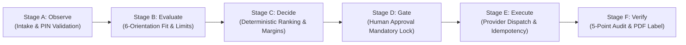
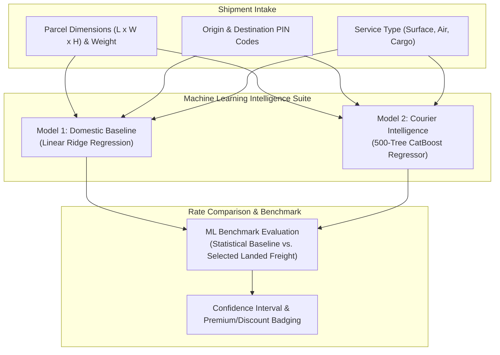
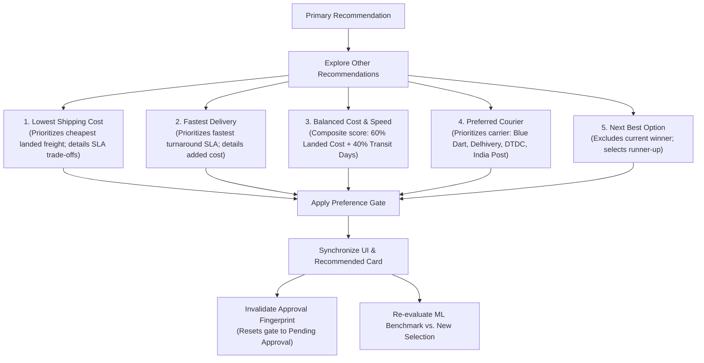
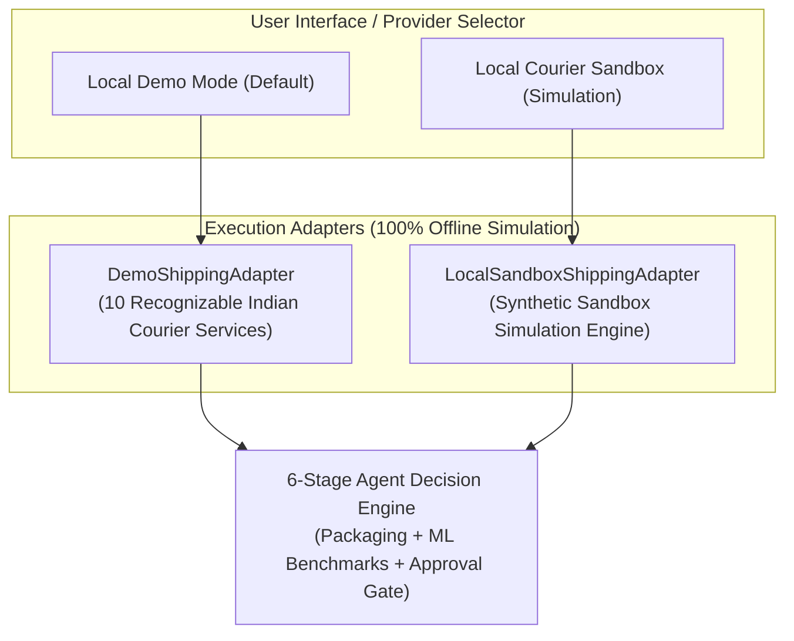

# Adaptive Shipping Intelligence Agent
> **Autonomous, Constraint-Aware Logistics Decision Support & Execution Gate Engine**  
> *Category:* Business & Productivity AI — ZiroDigital Agentic AI Hackathon 2026  
> *Production Deployment:* [https://adaptive-shipping-agent.vercel.app/](https://adaptive-shipping-agent.vercel.app/)  
> *Local Entrypoint:* `python app.py` (FastAPI backend + Responsive HTML/CSS/JS frontend on `http://localhost:8000`)  
> *Test Suite:* 100% Offline Passing | `python run_official_scenarios.py` (4/4 Passing) | `python run_demo_scenarios.py` (10/10 Passing)

---

## 1. Executive Summary & Problem Statement

E-commerce merchants, 3PL aggregators, and warehouse dispatch managers face substantial margin leakage from shipping inefficiencies:
1. **Volumetric Weight Surprises:** Bulky, lightweight items incur steep dimensional surcharges (up to 300% of base freight) when packaging is selected arbitrarily without 3D geometric optimization.
2. **Hidden Carrier Constraints:** Parcels exceeding courier-specific thresholds (e.g. length > 100 cm, girth > 300 cm, or hazardous material restrictions) are accepted at dispatch but penalized or rejected during hub sorting.
3. **Ghost Bookings & Double-Billing:** Network timeouts during carrier booking lead operators to blindly retry, creating duplicate waybills and unrecoverable freight charges.
4. **Stale Rates & Unserviceable PIN Codes:** Rates drift when quotes age past validity windows, and remote destinations cause booking failures if route serviceability isn't pre-validated.

The **Adaptive Shipping Intelligence Agent** solves these challenges through an autonomous, constraint-aware decision pipeline:
- **Autonomous 6-Orientation Packaging Optimization:** Evaluates 3D orthogonal fits against catalogue and custom box definitions, calculating exact volumetric freight savings.
- **Dual-Model Machine Learning Intelligence:** Integrated Model 1 (Domestic Baseline Regression) and Model 2 (CatBoost Courier Intelligence) providing statistical rate benchmarks, confidence intervals, and turnaround SLAs.
- **Interactive 5-Mode Alternative Recommendation Engine:** Dynamic re-ranking supporting Lowest Cost, Fastest Delivery, Balanced Composite, Preferred Carrier, and Next Best options.
- **Zero-Drift Safety & Reconciliation:** Enforces idempotency locks, timestamp freshness gating (<15m), and safe timeout recovery state machines.
- **Antigravity-Inspired Responsive UI:** Modern high-contrast dark blue & white dashboard with persistent locked sidebar, pinned header, and zero emojis.



---

## 2. 6-Stage Agentic Architecture

The agent executes a deterministic, auditable 6-stage lifecycle for every shipping dispatch:

| Stage | Name | Key Operations |
| :--- | :--- | :--- |
| **A** | **Observe** | Validates parcel measurements (length, width, height, dead weight), enforces positive non-zero inputs, sanitizes origin/destination Indian PIN codes, and checks verified postal serviceability. |
| **B** | **Evaluate** | Tests 3D 6-orientation orthogonal packaging fit, calculates volumetric weight across carrier-specific divisors (4000, 4500, 5000 cm³/kg), and checks courier dimension boundaries (length, girth, gross weight). |
| **C** | **Decide** | Calculates full landed cost (base freight slabs, fuel surcharges, COD handling, GST), executes deterministic multi-carrier ranking, runs Model 1 & Model 2 ML benchmarks, and generates explainable trade-off rationales. |
| **D** | **Gate** | Enforces a mandatory human-in-the-loop approval barrier. Prevents automated booking until an authorized operator confirms the dispatch. Cryptographically locks the approval fingerprint against price drift or measurement tampering. |
| **E** | **Execute** | Dispatches booking to the selected provider adapter under idempotency locking. Traps network timeouts into `CREATION_UNCERTAIN` state to eliminate blind retries and double-billing. |
| **F** | **Verify** | Executes an independent 5-point post-dispatch audit (AWB generated, order correlation, label correlation, pickup schedule confirmed, proposal match) and produces a printable PDF shipping label. |

---

## 3. Dual-Model Machine Learning Architecture

The agent incorporates two complementary machine learning models to provide transparent price benchmarks and market rate intelligence:



### Model 1: Domestic Baseline Price Prediction (`src/ml/price_prediction.py`)
- **Architecture:** Calibrated linear regression with distance, weight slab, and volumetric interaction features.
- **Purpose:** Estimates baseline market freight rates in INR (`₹`), generating 90% confidence intervals and quote variance badges (e.g. `Fair Market Rate`, `Below Benchmark (Savings)`, or `Premium Express`).
- **In-Situ Comparison:** Automatically compares the recommended quote against the baseline to surface transparent savings to the operator.

### Model 2: CatBoost Courier Intelligence (`src/ml/model2_adapter.py`)
- **Architecture:** 500-tree gradient boosted decision tree regressor (`catboost>=1.2.0`) optimized for tabular logistics attributes.
- **Purpose:** Predicts carrier-specific intelligence benchmarks, expected transit turnaround days (SLA), and pricing variances across Indian postal zones.
- **Serverless Ready:** Lightweight, self-contained model artifacts compressed for sub-second serverless execution on Vercel without heavy dependencies.

---

## 4. Interactive 5-Mode Alternative Recommendation Engine

When operators need an alternative to the default recommendation, the agent provides an interactive **Explore Other Recommendations** workflow with 5 distinct preference strategies:



1. **Lowest Shipping Cost (`lowest_cost`):** Identifies the cheapest eligible courier quote for the route and explains delivery-time trade-offs vs the baseline.
2. **Fastest Delivery (`fastest`):** Selects the fastest delivery SLA (e.g. Air Priority) and details the incremental freight cost.
3. **Balanced Cost & Speed (`balanced`):** Computes normalized composite scores:
   $$\text{Score} = 0.6 \times \text{norm}(\text{Cost}) + 0.4 \times \text{norm}(\text{Transit Days})$$
4. **Preferred Courier (`preferred_courier`):** Prioritizes the operator's chosen courier (Blue Dart, Delhivery, DTDC, India Post, XpressBees, Ecom Express). If unserviceable or unavailable for the destination PIN, it clearly explains the restriction reason and recommends the best eligible alternative.
5. **Next Best Alternative (`next_best`):** Excludes the current selection and returns the top-ranked alternative candidate.

**Approval Invalidation Guarantee:** Applying any alternative recommendation immediately invalidates previous human approvals, resetting the dispatch state to `Pending Approval` to prevent accidental dispatch under modified quote terms.

---

## 5. Technology Stack & Modern UI Architecture

| Layer | Technology | Key Details |
| :--- | :--- | :--- |
| **Backend API** | Python 3.10+, FastAPI, Uvicorn | Lightweight asynchronous REST API (`src/server.py`, `app.py`). |
| **Frontend UI** | HTML5, CSS3, Modular Vanilla JavaScript | High-contrast Antigravity-inspired design system (`static/`). Zero external JS frameworks, zero bloat. |
| **Data & Audit** | SQLite (WAL Mode), Pydantic v2 | Transactional persistence (`shipping_agent.db`), immutable audit log, idempotency lock table. |
| **Machine Learning** | CatBoost, Scikit-learn, Pandas | Dual-model pricing intelligence and SLA benchmarks (`src/ml/`). |
| **Documentation & Labels**| ReportLab | Compliant PDF shipping label generation (A6 and 4x6 formats) and SVG previews. |
| **Serverless Host** | Vercel Serverless Functions | Serverless entry point (`api/index.py`, `vercel.json`) optimized below platform bundle limits. |

### UI Layout Highlights
- **Persistent Left Navigation Sidebar:** Locked in place during scrolling, featuring 4 primary sections:
  1. *Rate Shipping Dispatch* (expanded with 4 nested subsections: Shipment Details, Carrier Rates, Approval Gate, Shipping Label)
  2. *Official Test Cases*
  3. *Packaging Optimizer*
  4. *Security Audit Logs*
- **Pinned Application Header:** Visible at all scroll positions with branding, Mode switcher (Local Demo / Sandbox), and live SQLite server status.
- **Independent Main Content Scroll:** Smooth scrolling container for wizard steps and test case results without shifting the sidebar.
- **Mobile Responsive Drawer:** Off-canvas drawer transition with backdrop overlay on viewports $\le 992\text{px}$.

---

## 6. Shipping Provider Modes: Simulation & Offline Sandbox

The application operates **100% locally and offline** without requiring external API keys, tokens, or live courier accounts:



- **Mode 1: Local Demo Mode (`demo` — Default):** Simulates 10 recognizable Indian courier services (Blue Dart Air Express, Delhivery Surface Standard, DTDC Heavy Cargo, India Post Parcel, XpressBees Same-Day, etc.) with realistic freight slabs, fuel surcharges, COD handling, and GST. Discloses all rates with `[DEMO DATA]` badges.
- **Mode 2: Local Courier Sandbox (`sandbox`):** Provides a self-contained offline sandbox simulation generating synthetic `SBX-TRK-` waybills, `SBX-PKP-` pickup confirmations, and watermarked PDF labels. Tagged with `source_type: "LOCAL_SANDBOX"`.

> [!NOTE]
> **SIMULATED COURIER OPTIONS — NOT LIVE CARRIER QUOTES**  
> All courier options, freight quotes, delivery timeframes, tracking numbers, and labels in this application are generated by deterministic local simulations for evaluation and testing. The application does not communicate with live carrier billing APIs or incur real-world freight commitments.

---

## 7. Quick Start & Setup Instructions

### Prerequisites
- Python 3.10, 3.11, 3.12, or 3.13
- Git

### 1. Clone the Repository
```powershell
git clone https://github.com/Thirumugilathavan/adaptive-shipping-agent.git
cd adaptive-shipping-agent
```

### 2. Set Up Virtual Environment & Install Dependencies
```powershell
python -m venv .venv
.\.venv\Scripts\Activate.ps1
pip install -r requirements.txt
```

### 3. Launch the Application
```powershell
python app.py
```
Open your browser to: **`http://localhost:8000`**

---

## 8. Testing & Verification

The test suite covers unit logic, provider simulation, 3D packaging, idempotency locks, ML prediction, and official hackathon scenarios:

```powershell
# 1. Run the official hackathon competition scenarios (TC1 - TC4)
python run_official_scenarios.py

# 2. Run the 10 evaluator edge-case scenarios (Demo A - Demo J)
python run_demo_scenarios.py

# 3. Run the complete pytest test suite
pytest -v

# 4. Run targeted tests for INR pricing, preferences, and sidebar navigation
pytest tests/test_inr_preferences_sidebar.py -v

# 5. Run Vercel serverless deployment verification tests
pytest tests/test_vercel_deployment.py -v
```

### Official Competition Scenarios Summary
- **[PASS] TC1: Same Parcel on Three Couriers** — Verified lowest cost ranking and itemized fee breakdown transparency.
- **[PASS] TC2: Large, Light Box (Volumetric Penalty)** — Verified courier-specific volumetric divisors (5000, 4500, 4000 cm³/kg).
- **[PASS] TC3: Destination PIN Not Serviceable** — Verified explicit rejection of remote PIN (791111) without price corruption.
- **[PASS] TC4: Label Created, AWB Matched & Pickup Verified** — Verified 5-point post-dispatch audit and printable label output.

---

## 9. Repository Structure

```
adaptive-shipping-agent/
├── api/
│   └── index.py                   # Vercel serverless function entrypoint
├── src/
│   ├── domain/
│   │   ├── advisor.py             # Smart Personalized Advisor & 5-Mode Alternative Engine
│   │   ├── benchmark.py           # Baseline vs. agent innovation benchmark
│   │   ├── dimension_engine.py    # Dimension validation & courier size constraints
│   │   ├── evaluator.py           # 10-scenario evaluation suite
│   │   ├── freshness.py           # Quote timestamp currency & drift detector
│   │   ├── label_generator.py     # Printable PDF & HTML label generation (A6 & 4x6)
│   │   ├── models.py              # Pydantic schemas (OrderInput, Address, CourierQuote, etc.)
│   │   ├── official_scenarios.py  # Official competition scenarios TC1 - TC4
│   │   ├── packaging.py           # 3D 6-orientation orthogonal fit & custom box engine
│   │   ├── pricing.py             # Slabs, fuel surcharges, COD fee & tax calculations
│   │   ├── ranking.py             # Deterministic courier ranking & margin calculator
│   │   ├── reconciliation.py      # Idempotent dispatch & timeout recovery service
│   │   ├── stress_tester.py       # Decision stability & perturbation lab
│   │   ├── verification.py        # Independent 5-point shipment verification audit
│   │   ├── weight.py              # Volumetric vs dead weight breakdown
│   │   └── workflow.py            # 6-Stage explainable agent decision engine
│   ├── ml/
│   │   ├── model2_adapter.py      # CatBoost Courier Intelligence adapter
│   │   └── price_prediction.py    # Domestic Baseline ML price prediction model
│   ├── persistence/
│   │   ├── audit.py               # Append-only SQLite audit logger
│   │   ├── database.py            # Database schema manager & connection pool
│   │   ├── idempotency.py         # Idempotency locks & timeout transition manager
│   │   └── state_machine.py       # Shipment lifecycle FSM & approval gate records
│   ├── providers/
│   │   ├── base.py                # CourierProvider abstract base class
│   │   ├── demo_adapter.py        # Simulated Indian couriers & Local Sandbox provider
│   │   └── registry.py            # Offline provider registry (Demo, Sandbox)
│   ├── server.py                  # FastAPI REST API & static asset serving
│   └── ui/
│       └── helpers.py             # Pure UI formatting helpers, PIN validation, currency
├── static/                        # Frontend UI (HTML5, Modern CSS, Modular Vanilla JS)
│   ├── index.html                 # Single-page application with persistent layout
│   ├── css/style.css              # Dark Blue / White high-contrast corporate theme
│   └── js/app.js                  # Async client handling wizard, rates, alternatives
├── tests/                         # Comprehensive pytest test suite (390+ tests)
├── models/                        # Pre-trained ML model artifacts
├── run_official_scenarios.py      # Standalone runner for TC1 - TC4
├── run_demo_scenarios.py          # Standalone runner for Demo A - Demo J
├── app.py                         # Application local entry point (FastAPI server)
├── vercel.json                    # Vercel serverless deployment configuration
├── requirements.txt               # Production Python dependencies
└── README.md                      # Comprehensive project documentation
```

---

## 10. Hackathon Compliance & Integrity Disclosure

- **Authentic Local Simulation:** All courier quotes, tracking numbers, and labels are 100% simulated offline without external courier APIs.
- **Zero API Keys Required:** Runs out-of-the-box on any standard Python environment without credentials or network requirements.
- **Idempotency & Safety:** Dispatches are gated behind cryptographically verifiable approval hashes and idempotency locks.
- **Accessible Design:** Corporate dark blue and white high-contrast interface adhering to web accessibility guidelines with zero emojis.
