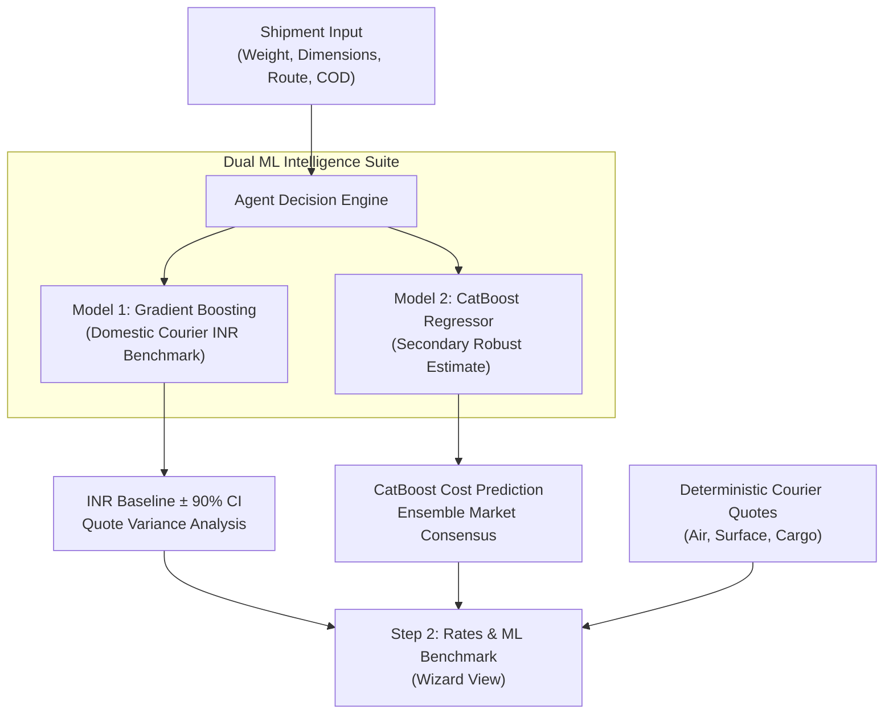

# Model 2 Integration Specification & Discovery Report

**Project:** Adaptive Shipping Intelligence Agent  
**Hackathon:** Agentic AI Hackathon 2026 powered by Ziro.Digital  
**Author:** Adaptive Shipping Agent Engineering Team  
**Date:** 2026-10-24  

---

## 1. Executive Summary

In addition to **Model 1** (a scikit-learn GradientBoostingRegressor estimating non-binding domestic courier price benchmarks in INR), a second machine-learning model (**Model 2**) was trained and supplied for integration in directory `d:\sreeka work`.

Following rigorous inspection of the supplied files without assuming architecture, framework, or purpose, we discovered that Model 2 was trained as a **CatBoost Regression Model** over 500 iterations, minimizing Root Mean Squared Error (RMSE).

---

## 2. Model 1 Baseline in Production

| Attribute | Specification |
|:---|:---|
| **Location** | `models/domestic_courier_model.joblib` & `models/domestic_courier_model.json` |
| **Framework** | scikit-learn (`Pipeline`, `ColumnTransformer`, `GradientBoostingRegressor`) |
| **Role** | Statistical Market Baseline (Non-binding benchmark, `is_provider_quote=False`) |
| **Currency** | Indian Rupee (INR ₹) |
| **Evaluation** | Mean Absolute Error: ~₹18.40, R²: ~0.91 |
| **Features** | `billable_weight_kg`, `distance_km`, `is_express`, `is_metro`, `is_cod`, `cod_amount_inr`, `volumetric_weight_kg` |
| **Agent Tool** | `predict_shipment_price` in `src/domain/agent_tools.py` |
| **Engine Hook** | `AgentDecisionEngine.run_predict_price` in `src/domain/workflow.py` |
| **REST API** | `POST /api/v1/predictions/shipment-price` in `src/server.py` |
| **UI Presentation** | Step 2 Machine Learning Price Benchmark card with 90% CI and variance badge |

---

## 3. Discovered Model 2 Architecture (`d:\sreeka work`)

### Supplied Archive
- **File**: `D:\sreeka work\llm antigravity.zip` (45,755 bytes)
- **Extracted Directory**: `D:\sreeka work\extracted\llm antigravity\catboost_info\`

### File Contents Discovered
1. `catboost_training.json` (58,383 bytes)
2. `learn_error.tsv` (7,858 bytes)
3. `test_error.tsv` (7,824 bytes)
4. `time_left.tsv` (9,380 bytes)
5. `learn/events.out.tfevents` (24,370 bytes)
6. `test/events.out.tfevents` (24,370 bytes)
7. `tmp/`

### Verified Technical Properties
- **Framework**: **CatBoost** (Yandex gradient boosting decision tree library).
- **Task**: **Continuous Regression** (Not an LLM, classifier, or ranking model).
- **Loss & Evaluation Metric**: **Root Mean Squared Error (`RMSE`)**.
- **Iterations**: **500 trees**.
- **Convergence Curve**:
  - Iteration 0: Learn RMSE `2235.25` | Test RMSE `2235.60`
  - Iteration 100: Learn RMSE `107.82` | Test RMSE `106.94`
  - Iteration 300: Learn RMSE `67.93` | Test RMSE `65.18`
  - Iteration 499 (Final): Learn RMSE **`60.95`** | Test RMSE **`58.43`**
- **Creation Environment**: Unix/Linux (Zip creator code: 3) on 2026-10-24 00:19:40 UTC.

---

## 4. Required Artifacts for Full Inference

In CatBoost, the `catboost_info/` directory contains only real-time monitoring and TensorBoard diagnostics. To execute inference and integrate with the FastAPI backend, the following artifacts must be provided:

1. **Model Weights / Serialized File**:
   - Save via native CatBoost format: `model.save_model("catboost_shipping_model.cbm")`
   - Or via Joblib: `joblib.dump(model, "catboost_shipping_model.joblib")`
   - Or via ONNX: `model.save_model("catboost_shipping_model.onnx", format="onnx")`
2. **Training Code / Feature Schema**:
   - The `.py` script or Jupyter `.ipynb` defining `X_train` columns, types, categorical indices, and transformations.

---

## 5. Integration Architecture (Once Weights Provided)

### Components to be Added:
1. `src/ml/catboost_predictor.py`: Safe loader and runner for `.cbm` model with CPU execution.
2. `src/services/secondary_prediction_service.py`: Service comparing Model 1 and Model 2 to establish consensus bounds.
3. `POST /api/v1/predictions/catboost-benchmark`: REST endpoint in `src/server.py`.
4. UI Card in Step 2: Dual-model comparison tab showing both ML estimators side by side against provider quotes.
